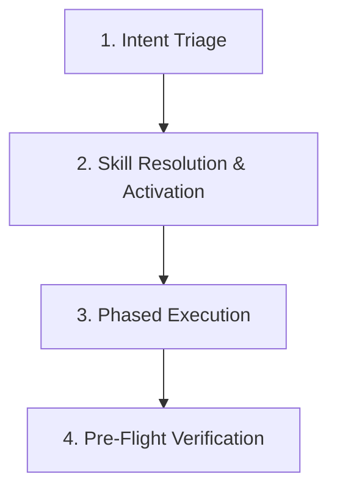

# 🎼 ORCHESTRATOR: Master Meta-Agent Protocol

Dokumen ini adalah protokol utama bagi AI Coding Agent dalam mengelola dan mengeksekusi setiap tugas di repositori ini.

---

## 🔄 4-Langkah Siklus Kerja (Execution Lifecycle)

### Langkah 1: Intent Triage (Klasifikasi Niat)
Analisis prompt pengguna secara mendalam sebelum menyentuh file:
* **Domain UI / Frontend:** Pembuatan/perubahan halaman, komponen, styling, animasi, responsif mobile.
* **Domain Backend / API / Database:** Endpoint REST, skema database, migrasi data, autentikasi.
* **Domain Tooling / DevOps:** Build configuration, Docker, CI/CD, linting.
* **Domain AI / Analytics:** Inferensi model, prompt engineering, agent setup.

### Langkah 2: Skill Resolution & Activation
Buka [SKILL_ROUTER.md](SKILL_ROUTER.md) dan tentukan skill wajib yang harus dimuat:
* UI & Desain ➔ Muat `design-taste-frontend` + `responsive-craft`.
* Kode Produksi Panjang ➔ Muat `full-output-enforcement`.
* Integrasi Modern Library ➔ Muat `context7-mcp`.
* Testing & Scraping ➔ Muat `browser-use`.

### Langkah 3: Phased Execution (Eksekusi Bertahap)
Jalankan pengerjaan secara metodis mengikuti SOP pada [WORKFLOWS.md](WORKFLOWS.md). Jangan langsung mengubah 10 file sekaligus; lakukan verifikasi bertahap.

### Langkah 4: Pre-Flight Verification (Validasi Sebelum Serah Terima)
Sebelum menyatakan pekerjaan selesai kepada pengguna, pastikan:
1. Tidak ada error type check atau linting (`tsc --noEmit`, `npm run lint`).
2. Tidak ada kode terpotong (`// TODO`, `...`).
3. Tampilan responsif mobile teruji aman.
