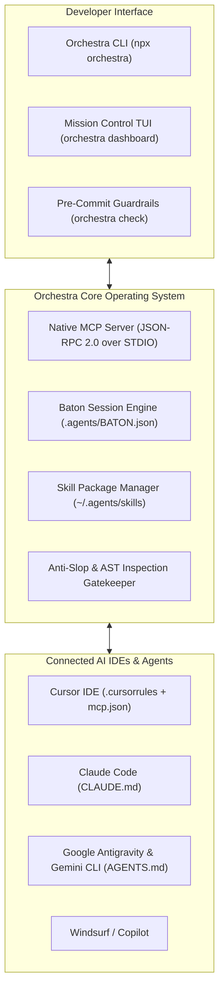

# 🎻 ORCHESTRA

> **The Symphony Multi-Agent Operating System & Scaffolding Protocol**  
> *Transform chaotic AI chatter into harmonious, enterprise-grade software development.*

[](package.json)
[](LICENSE)
[](package.json)
[](package.json)
[](AGENTS.md)

---

## 📖 1. Latar Belakang: Krisis di Balik Ledakan AI Coding

Proyek **Orchestra** tidak lahir dari angan-angan teoritis di atas kertas, melainkan dari **kenyataan lapangan dan rasa frustrasi nyata** saat dilakukan audit mendalam terhadap **21 repositori multi-agent** di laptop Rey Cannavaro (seperti `shape-tool`, `urbangrow-workspace`, `see-mbg`, dan `asterisk`).

Ketika dunia menyambut era AI Coding (Cursor, Claude Code, Antigravity, Copilot), hampir semua developer menghadapi **5 krisis akut yang sama**:

1. 🗣️ **Agent Chatter & Halusinasi Liar:**  
   Ketika beberapa agent AI bekerja bersamaan tanpa batasan peran, mereka saling bertumpuk argumen. Hasilnya adalah *kebisingan (noise)* dan halusinasi, bukan kode yang berfungsi.
2. ✂️ **Pemotongan Kode Malas (*Lazy Code & Truncation*):**  
   Untuk menghemat output token, LLM secara default sering menulis komentar jalan pintas di tengah logika krusial:
   ```typescript
   // TODO: implement later
   // ... rest of code
   ```
   Hal ini merusak logika aplikasi dan menyebabkan runtime failure di produksi.
3. 🎨 **Ledakan Desain Murahan (*The AI-Slop Epidemic*):**  
   AI secara seragam menghasilkan palette generik yang norak: gradient ungu-pink murahan (`from-purple-500 to-pink-500`), shadow neon berlebihan, dan elemen button tanpa interactive hover/focus states yang merusak martabat visual produk.
4. 💥 **Amnesia AI & Konflik Mutasi File (*Race Conditions*):**  
   Saat sesi percakapan memanjang atau developer berpindah editor (misal: dari Cursor ke Claude Code atau Antigravity), AI kehilangan memori konteks. Dua prompt bisa menimpa file yang sama secara bertabrakan, menghapus pekerjaan jam sebelumnya.
5. 📂 **Redundansi Puluhan Ribu Baris Skill Tercecer:**  
   Pustaka 23+ skill berukuran ribuan baris harus di-copy-paste manual ke setiap repositori baru. Begitu ada pembaruan pada 1 skill, puluhan proyek lainnya langsung basi (*drift*).

> **Akar Masalah:**  
> Model AI saat ini sangat cerdas, tetapi **tidak memiliki disiplin kerja**. Mereka seperti 100 musisi jenius di satu panggung yang meniup terompet dan menggesek biola bersamaan tanpa aturan — hasilnya adalah **kekacauan (chaos)**.

---

## 🎼 2. Visi Agung: Paradigma Orkestra Simfoni

Filosofi inti Orchestra meminjam metafora **Orkestra Simfoni**:

> *"Musik simfoni yang megah tidak lahir dari musisi yang paling keras bersuara, melainkan dari partitur yang presisi, dirigen yang disiplin, dan giliran instrumen yang teratur."*

### Visi Utama Orchestra:
> **Menjadikan Orchestra sebagai *Universal Operating System* untuk Rekayasa Perangkat Lunak Multi-Agent Otonom — mentransformasikan AI dari sekadar chatbot pengetik kode pasif menjadi divisi software engineering aktif, disiplin, berstandar enterprise, dan bebas cacat.**

Orchestra merevolusi cara kerja AI melalui 5 instrumen simfoni:
* 📜 **The Score (`AGENTS.md`):** Partitur musik sebagai satu-satunya rujukan spesifikasi absolut (*Ground Truth*).
* 🎼 **The Conductor (`ORCHESTRATOR.md`):** Dirigen yang mengatur tempo dan siklus kerja 4 tahap: *Intent Triage ➔ Skill Resolution ➔ Phased Execution ➔ Pre-Flight Verification*.
* 🪄 **The Baton Protocol (`.agents/BATON.json`):** Menerapkan prinsip *Single-Writer Invariant*. Hanya agen pemegang tongkat yang berhak memutasi file.
* 🛡️ **The Gatekeeper (`orchestra check`):** Kurator kualitas yang memastikan nada tidak fals—menolak kode terpotong dan desain AI-slop sebelum masuk ke Git commit.
* 🖥️ **Mission Control (`orchestra dashboard`):** Ruang kendali TUI interaktif tempat developer mengawasi dan mengarahkan seluruh ekosistem agent secara real-time.

---

## 💥 3. Dampak Nyata (*The Triple-Level Transformative Impact*)

Membangun Orchestra bukan sekadar membuat CLI biasa; kita menciptakan **lompatan dampak sistemik** di 3 tingkatan:

### 👤 A. Bagi Solo Builder & Developer
* **Mengubah 1 Developer Menjadi "10x Engineering Director":**  
  Anda tidak lagi menghabiskan waktu merapikan kode malas AI atau mengawasi sintaks baris demi baris. Anda bertindak sebagai **Grand Conductor**, sementara para subagent bertindak sebagai instrumen spesialis Anda.
* **Kecepatan Setup Instan (Hitungan Detik):**  
  Ketika memiliki ide startup baru malam ini, Anda tidak perlu menghabiskan 3 jam mengatur prompt dan skill. Cukup jalankan `npx orchestra init`, dalam 5 detik seluruh arsitektur multi-agent enterprise sudah terpasang.
* **Bebas Beban Kognitif (*Zero Cognitive Fatigue*):**  
  Anda tidak perlu menghafal 23 skill; Orchestra menyuapkan konteks dan token desain secara presisi ke AI via native MCP Server saat dibutuhkan.

### 🏢 B. Bagi Tim Engineering & Perusahaan
* **Menghilangkan "AI Technical Debt":**  
  Perusahaan tidak perlu lagi takut kode AI merusak arsitektur mereka. Gatekeeper Orchestra menjamin setiap baris kode yang masuk ke Pull Request (PR) bebas `// TODO`, terkompilasi utuh, dan otomatis menghasilkan dokumentasi Keputusan Arsitektur resmi ([docs/ADR.md](docs/ADR.md)).
* **Standarisasi Kualitas Otomatis:**  
  Setiap developer—baik senior, junior, maupun AI assistant yang berbeda—dipaksa mematuhi standar kualitas kode dan visual yang seragam melalui Git pre-commit guardrails.
* **Kebebasan Lintas Editor (*Cross-IDE Harmony*):**  
  Developer A menyukai Cursor, Developer B memakai Claude Code, dan Developer C menggunakan Google Antigravity. Orchestra menjadi jembatan pemersatu; mereka semua beroperasi di atas partitur yang sama tanpa konflik state.

### 🌐 C. Bagi Industri AI & Open-Source Global
* **Mendefinisikan Standar Pasca-Chatbot (*Post-Chatbot OS*):**  
  Orchestra membuktikan bahwa sistem multi-agent otonom tidak membutuhkan framework monolitik yang lambat dan memakan memori; Orchestra membuktikannya dengan arsitektur **Zero-Dependency, instan <15ms, dan berjalan di atas protokol terbuka (JSON-RPC 2.0 MCP & Git)**.
* **Penyelamatan Estetika Visual Software:**  
  Dengan aturan ketat anti-slop, Orchestra menolak gelombang software murahan hasil template AI dan mengembalikan standar visual kelas dunia (minimalist, brutalist, Swiss typography, responsive agency-grade) ke industri perangkat lunak.

---

## 🏛️ 4. Arsitektur Sistem 3-Lapisan



---

## ⚡ 5. Quickstart: Cara Pakai

### Opsi 1: Pasang ke Proyek Apapun (Rekomendasi)
Masuk ke folder proyek Anda, lalu jalankan:

```bash
npx orchestra init
```

*Atau langsung dari GitHub tanpa publish ke registry:*
```bash
npx github:ReyCannavaro/orchestra init
```

*Mode Otomatis / Non-Interaktif:*
```bash
# Otomatis deteksi stack & pasang tanpa konfirmasi prompt
npx orchestra init -y

# Pilih preset spesifik secara langsung
npx orchestra init --preset nextjs-fullstack -y
```

CLI cerdas Orchestra akan:
1. Mendeteksi jenis stack Anda (Next.js, Flutter, Python, Monorepo, Node.js).
2. Memasang file direktif `AGENTS.md`, `.agents/ORCHESTRATOR.md`, `.agents/SKILL_ROUTER.md`, `.agents/WORKFLOWS.md`.
3. Membangun jembatan otomatis `.cursorrules`, `CLAUDE.md`, dan `.cursor/mcp.json`.

---

### Opsi 2: Pasang Pustaka Core Skills Global (One-Time Setup)

Agar seluruh proyek di laptop Anda bisa mengakses 23+ skill secara otomatis tanpa duplikasi file:

* **Di Windows (PowerShell):**
  ```powershell
  irm https://raw.githubusercontent.com/ReyCannavaro/orchestra/main/install.ps1 | iex
  ```
* **Di macOS / Linux:**
  ```bash
  curl -fsSL https://raw.githubusercontent.com/ReyCannavaro/orchestra/main/install.sh | bash
  ```
* **Atau via CLI lokal:**
  ```bash
  npx orchestra setup-global
  ```

---

## 🌟 6. Lima Pilar Produksi Orchestra 2.0

### 🖥️ Pilar 1: Interactive Mission Control Dashboard (`orchestra dashboard`)

Orchestra menyertakan antarmuka **Terminal User Interface (TUI)** murni (*Zero-Dependency ANSI Box-Drawing Engine*) yang memvisualisasikan ekosistem agent secara real-time:

```bash
npx orchestra dashboard
# atau alias singkat:
npx orchestra ui
```

```text
┌──────────────────────────────────────────────────────────────────────────────┐
│ 🎻 ORCHESTRA MISSION CONTROL v2.0.0                         By Rey Cannavaro │
├──────────────────────────────────────────────────────────────────────────────┤
│ Workspace: ...s\Rey Cannavaro\orchestra │ Stack: Node.js / Web               │
│ MCP Engine: CONNECTED ✔              │ Last Sync: 10:29:28                   │
├──────────────────────────────────────────────────────────────────────────────┤
│ 📊 AGENT INTEGRITY & HEALTH          │ 🗺️ SKILLS INVENTORY                  │
│ • Status: ✔ 100% Intact (8 files)    │ • Global Hub: 48 global skills        │
│ • Directives: AGENTS.md              │ • Local Hub:  0 local project skills  │
│ • Multi-IDE:  Cursor & Claude Bridge │ • Registry:   23 Core Skills          │
├──────────────────────────────────────────────────────────────────────────────┤
│ 🎯 ACTIVE BATON PROTOCOL SESSION                                             │
│ • Goal:   Orchestra 2.0 Evolution: Autonomous AI Multi-Agent Operating Sys   │
│ • Baton:  conductor [COMPLETED] • Phase: 1_intent_triage                     │
│                                                                              │
│   Roadmap Progress:                                                          │
│     [✔] Step 1: Quality Gatekeeper CLI (orchestra check)                     │
│     [✔] Step 2: Dynamic Baton Protocol & Session Continuity                  │
│     [✔] Step 3: Modular Skill Registry & Package Manager                     │
│     [✔] Step 4: Native Orchestra MCP Server                                  │
│     [✔] Step 5: Interactive Mission Control Dashboard                        │
├──────────────────────────────────────────────────────────────────────────────┤
│ ⚡ Status: Static snapshot mode                                               │
├──────────────────────────────────────────────────────────────────────────────┤
│ [C] Check  [B] Advance Baton  [M] Setup MCP  [R] Refresh  [Q] Quit           │
└──────────────────────────────────────────────────────────────────────────────┘
```

#### ✨ Hotkey Navigasi Interaktif:
* `[c]` Jalankan Quality Gatekeeper (`orchestra check`) secara instan.
* `[b]` Majukan langkah aktif pada Baton roadmap (`orchestra session checkpoint`).
* `[m]` Otomatis konfigurasi MCP server untuk IDE (`orchestra mcp-setup`).
* `[r]` Refresh data status sistem secara real-time.
* `[q]` Keluar dari Mission Control.
*(Otomatis beralih ke mode Static Snapshot yang ramah CI/Piped output jika terminal tidak mendukung TTY raw mode).*

---

### 🔌 Pilar 2: Native Orchestra MCP Server (Model Context Protocol)

Orchestra menyertakan server MCP native bawaan (**Zero-Dependency, instan <10ms, berbasis JSON-RPC 2.0 over STDIO**) yang menghubungkan Cursor, Claude Desktop, dan Antigravity langsung ke tools aktif:

```bash
# Otomatis konfigurasi IDE (Cursor .cursor/mcp.json, Claude, Antigravity)
npx orchestra mcp-setup

# Jalankan MCP Server di terminal
npx orchestra mcp
```

#### 🛠️ 6 Tools Aktif yang Disediakan untuk AI:
| Tool Name | Fungsi & Nilai Manfaat |
|---|---|
| `orchestra_resolve_skill` | AI mengirimkan deskripsi tugas, Orchestra langsung mengembalikan aturan teknis & token desain yang relevan tanpa memenuhi context window di awal. |
| `orchestra_acquire_baton` | Menerapkan *Single-Writer Invariant*, mengunci giliran mutasi file untuk role agent tertentu (`conductor`, `frontend`, `backend`, `qa`). |
| `orchestra_release_baton` | Melepaskan baton lock, menandai kemajuan roadmap, mencatat touched files, dan mendokumentasikan Keputusan Arsitektur (ADR). |
| `orchestra_verify_diff` | Menjalankan scanner quality gatekeeper (anti-slop & truncation) sebelum AI menyatakan tugas selesai. |
| `orchestra_session_status` | Membaca status sesi aktif, tujuan pengerjaan, roadmap progress, dan pemegang baton saat ini. |
| `orchestra_list_skills` | Menelusuri seluruh pustaka skill yang tersedia di registry lokal dan global. |

---

### 📦 Pilar 3: Modular Skill Registry & Package Manager (`orchestra skill`)

Orchestra berfungsi sebagai package manager khusus untuk AI Skills layaknya Homebrew atau NPM:

```bash
# Cari skill berdasarkan kata kunci atau tag di registry
npx orchestra skill search stripe
npx orchestra skill search design

# Install skill spesifik (default global ke ~/.agents/skills atau --local ke repo saat ini)
npx orchestra skill add design-taste-frontend
npx orchestra skill add brandkit --local

# Lihat daftar seluruh skill yang terpasang di sistem & proyek
npx orchestra skill list

# Scaffold template skill baru berstandar enterprise (manifest skill.json + petunjuk SKILL.md)
npx orchestra skill new payment-gateway --desc "Stripe and Midtrans payment integration"

# Perbarui atau hapus skill
npx orchestra skill update --all
npx orchestra skill remove old-skill

# Sinkronisasi seluruh 23 core skills ke folder hub global laptop
npx orchestra setup-global
```

Setiap skill yang di-install secara otomatis didaftarkan ke dalam matriks `SKILL_ROUTER.md` agar AI dapat langsung memanggilnya secara *on-demand*.

---

### 📜 Pilar 4: The Baton Protocol & Session Continuity (`orchestra session`)

Untuk mengatasi masalah **AI amnesia** saat sesi percakapan panjang, token context window habis, atau saat berpindah antar editor (misal: Cursor ➔ Claude Code ➔ Antigravity), Orchestra menyediakan **Baton Protocol**:

```bash
# Mulai sesi pengerjaan baru dengan roadmap otomatis
npx orchestra session start "Implementasi Sistem Pembayaran Midtrans"

# Catat checkpoint: langkah 1 selesai & catat file yang dimutasi
npx orchestra session checkpoint --step 1 --done --touch src/payment.ts --adr "ADR-001: Gunakan Core API Midtrans"

# Lihat status sesi, pemegang baton, dan progress roadmap
npx orchestra session status

# Kunci baton untuk spesialis tertentu
npx orchestra session acquire backend

# Lepaskan baton kembali ke konduktor
npx orchestra session release

# Selesaikan sesi (otomatis jalankan verifikasi pre-flight & ekspor docs/ADR.md)
npx orchestra session end
```

State disimpan di `.agents/BATON.json`. Setiap AI yang membaca repositori ini akan langsung mengenali langkah apa yang sedang dikerjakan dan dilarang menimpa kode yang sudah selesai!

---

### 🛡️ Pilar 5: Quality Gatekeeper CLI (`orchestra check`)

Orchestra menyertakan scanner otomatis untuk memastikan AI tidak memasukkan kode rusak ke repository Anda:

```bash
# Periksa file yang baru diubah sebelum commit
npx orchestra check

# Mode cepat: jalankan scanner regex AST, lewati compiler lambat
npx orchestra check --fast

# Otomatis pasang hook Git pre-commit agar tidak ada kode cacat yang bisa di-commit
npx orchestra install-hook

# Generate workflow GitHub Actions untuk proteksi Pull Request
npx orchestra init-ci
```

#### 🔬 4 Lapisan Verifikasi Gatekeeper:
1. 🚫 **Anti-Truncation Guard:** Mendeteksi `// TODO`, `// ... rest of code`, fungsi stub kosong, dan `throw new NotImplementedError`.
2. 🎨 **Anti-Slop Visual Inspector:** Mendeteksi gradient AI generik (`purple-500 -> pink-500`), shadow neon berlebihan, dan elemen button tanpa interactive hover/focus states.
3. ⚙️ **Compiler & Linter Runner:** Menjalankan `tsc`, `flutter analyze`, atau `eslint` secara otomatis.
4. 🩺 **Agent Health & Integrity:** Memverifikasi keberadaan dan keutuhan konfigurasi `AGENTS.md`, `.agents/`, `.cursorrules`, dan `CLAUDE.md`.

---

## 🎛️ 7. Daftar Lengkap Perintah CLI

```text
USAGE:
  npx orchestra <command> [subcommand] [options]

CORE COMMANDS:
  init                    Scaffold Orchestra multi-agent architecture in current repository
  dashboard, ui           Launch interactive Mission Control Terminal Dashboard (TUI)
  check, doctor           Run Quality Gatekeeper (Anti-Slop, Anti-Truncation, Agent Health)
  install-hook            Install Git pre-commit guardrail hook to prevent bad commits
  init-ci                 Generate GitHub Actions CI workflow for PR verification
  setup-global            Install/Sync 23+ core skills to ~/.agents/skills (Global Hub)
  version, -v             Display Orchestra version
  help, --help            Show this help menu

NATIVE MCP SERVER COMMANDS:
  mcp                     Start the native JSON-RPC 2.0 Orchestra MCP Server on STDIO
  mcp-setup               Auto-configure IDEs (Cursor .cursor/mcp.json, Claude, Antigravity)

SKILL PACKAGE MANAGER COMMANDS:
  skill list              List installed skills (global & local project skills)
  skill search <query>    Search skills in the Orchestra registry by keyword/tag
  skill add <name>        Install a skill from registry (--global or --local)
  skill remove <name>     Remove an installed skill
  skill update [name]     Update installed skill(s) to latest version
  skill new <name>        Scaffold a new modular skill with standard manifest & templates

BATON PROTOCOL & SESSION COMMANDS:
  session start <goal>    Initialize an orchestrated task session with roadmap tracking
  session status          Display active session status, baton holder, roadmap, and ADRs
  session checkpoint      Update roadmap step, record touched files, or log an ADR
  session acquire <role>  Acquire baton lock for an agent role (frontend, backend, etc.)
  session release         Release current baton lock to idle state
  session end             Conclude session, run pre-flight check, and export ADRs
```

---

## 📚 8. Pustaka 23+ Core Skills Terpasang

Orchestra menyertakan pustaka skill kelas dunia yang siap dipanggil:

* 🎨 **Desain & Anti-Slop:**
  * `design-taste-frontend`: Panduan styling anti-slop, komposisi layout modern, dan tipografi agency-grade.
  * `high-end-visual-design`: Standar estetika editorial mewah dan harmoni spasial.
  * `minimalist-ui`: Antarmuka monokrom editorial bersih dengan spacing disiplin.
  * `industrial-brutalist-ui`: Estetika cetak tipografi Swiss dipadu brutalism industrial taktil.
  * `responsive-craft`: Pola responsive multi-breakpoint untuk mobile, tablet, dan desktop.
  * `stitch-design-taste`: Tata kelola dan token design system untuk Google Stitch.
  * `brandkit`: Arahan palet warna, tipografi, dan token brand kit premium.
* ⚡ **Rekayasa Kode & Integritas:**
  * `full-output-enforcement`: Menolak pemotongan kode LLM dan mewajibkan kode kompilabel utuh.
  * `context7-mcp`: Panduan integrasi dokumentasi API library real-time.
  * `image-to-code`: Konversi screenshot dan mockup Figma menjadi kode Tailwind/React akurat.
* 🧪 **Testing & Browser:**
  * `browser-use`: Otomasi browser Playwright untuk web testing dan form testing.
  * `valyu-best-practices`: Toolkit pencarian data dan sitasi untuk agen AI.
* 🤖 **Pengembangan Agent & Ekosistem:**
  * `agent-development`: Perancangan subagent otonom dan sistem persona.
  * `skill-development`: Pembuatan modul skill baru berstandar manifest.
  * `hook-development`: Rekayasa hook otomatisasi dan lifecycle event.
  * `mcp-integration`: Panduan pembuatan tool MCP server kustom.

---

## 🌐 9. Kompatibilitas Lintas Alat AI

Orchestra dirancang dengan standar universal:
* ✅ **Google Antigravity & Gemini CLI** (Native `AGENTS.md`)
* ✅ **Cursor IDE** (Otomatis bridge via `.cursorrules` & `.cursor/mcp.json`)
* ✅ **Claude Code & Claude Desktop** (Otomatis bridge via `CLAUDE.md` & MCP)
* ✅ **Windsurf & Cascade**
* ✅ **GitHub Copilot / VS Code**

---

## 🏛️ 10. Dokumen Rujukan & Roadmap

* Ingin melihat keputusan arsitektur yang diekspor otomatis oleh Baton Protocol?  
  👉 [**`docs/ADR.md`**](docs/ADR.md)
* Ingin membaca analisis komparatif 21 repositori multi-agent sebelumnya?  
  👉 [**`docs/ANALYSIS_REPORT.md`**](docs/ANALYSIS_REPORT.md)
* Ingin melihat blueprint mendalam 5 pilar evolusi Orchestra?  
  👉 [**`docs/ROADMAP.md`**](docs/ROADMAP.md)
* Ingin melihat strategi Next Horizons (NPM, CI Marketplace, dan Rilis Resmi)?  
  👉 [**`docs/NEXT_HORIZONS_STRATEGY.md`**](docs/NEXT_HORIZONS_STRATEGY.md)

---

## 📄 11. Lisensi

Dilisensikan di bawah [MIT License](LICENSE).  
Diciptakan dengan dedikasi untuk masa depan rekayasa perangkat lunak otonom oleh **Rey Cannavaro**.
