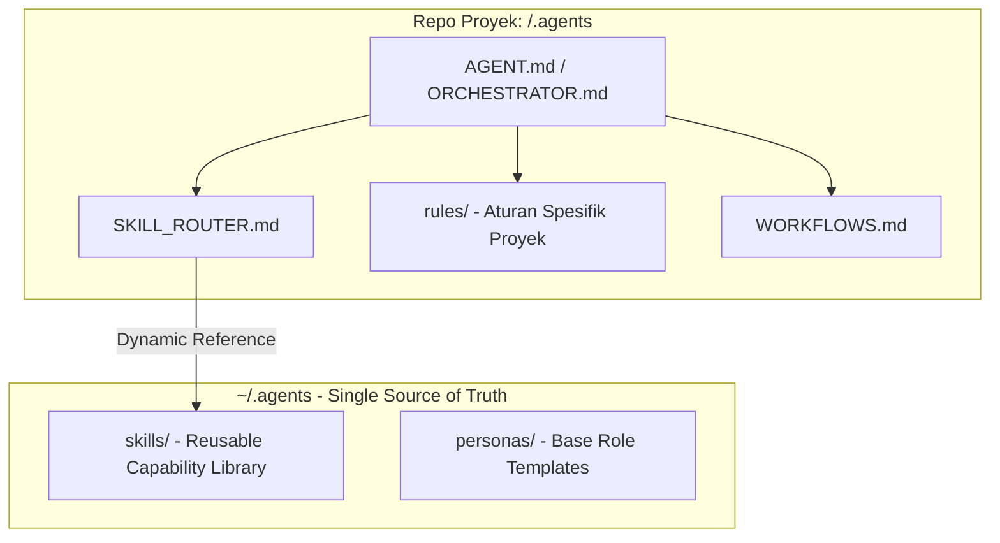

# 🕵️‍♂️ Laporan Analisis Mendalam: Audit Direktori `.agents` & Rekomendasi Setup Universal

> **Tanggal Audit:** 14 November 2026  
> **Lingkup Pemeriksaan:** Workspace `C:\Users\Rey Cannavaro\`  
> **Objek Analisis:** 21 Repositori / Folder yang memuat direktori `.agents`  

---

## 📌 1. Ringkasan Eksekutif & Inventarisasi Folder

Dari hasil pemindaian mendalam di seluruh workspace root laptop Anda, ditemukan total **21 lokasi** yang memiliki folder `.agents`. Lokasi-lokasi ini terbagi menjadi 4 kluster berdasarkan kematangan dan kompleksitasnya:

| Kategori | Jumlah | Contoh Path / Repositori |
| :--- | :---: | :--- |
| **Tier 1: Ultra-Kompleks (Orchestration & Custom Architecture)** | 4 | `shape-tool`, `urbangrow-workspace`, `asterisk`, `see-mbg` |
| **Tier 2: Baseline Skill Pack (Lengkap namun Standar)** | 3 | Global `~/.agents`, `jhic`, `wayang` |
| **Tier 3: Minimalis / Khusus (1-2 Skills/Plugin)** | 3 | `develop/flutter`, `vast`, `.codex/.tmp/plugins` |
| **Tier 4: Empty Scaffold (Folder Kosong / Inisialisasi CLI)** | 11 | `bosbaut`, `vii`, `absensi_hris_budijaya`, `findor`, `UrbangrowApp`, `fe-real-estate-hutomo`, `findor-vanilla`, `findor-static`, `rey-portofolio`, `rephone-pos`, `NusaExplore-Vanilla` |

---

## 📊 2. Matriks Perbandingan Proyek Teratas (Quantitative & Qualitative)

Berikut adalah statistik teknis dari proyek-proyek yang memiliki implementasi `.agents` aktif:

| Repositori | Files | Total Lines | Ukuran (KB) | Skills | Rules | Orchestrator / Personas | Model Arsitektur Utama |
| :--- | :---: | :---: | :---: | :---: | :---: | :---: | :--- |
| **`shape-tool`** | **130** | **37.408** | **1.408 KB** | 28 | 0 | 15 Personas (~10.300 baris) | **Symphony Paradigm & Baton Protocol** |
| **`urbangrow-workspace`** | **127** | **26.976** | **950 KB** | 28 | 10 | 7 Distributed Guides | **Hierarchical Domain-Driven Monorepo** |
| **`asterisk`** | 118 | 25.553 | 899 KB | 24 | 1 | 3 Meta-Agent SOPs | **Intent Triage & Skill Router** |
| **`see-mbg`** | 115 | 24.984 | 877 KB | 23 | 2 | 3 Meta-Agent SOPs | **Intent Triage & Skill Router** |
| **`~/.agents` (Global)** | 111 | 25.036 | 877 KB | 23 | 0 | - | **Global Skill Repository** (`.skill-lock.json`) |
| **`jhic`** | 110 | 24.824 | 868 KB | 23 | 0 | - | Replikasi Global Skills |
| **`wayang`** | 110 | 24.824 | 880 KB | 23 | 0 | - | Replikasi Global Skills |
| **`develop/flutter`** | 2 | 67 | 4,7 KB | 1 | 0 | - | `find-release` skill saja |
| **`vast`** | 1 | 1.206 | 86,4 KB | 1 | 0 | - | `design-taste-frontend` skill saja |

---

## 🔬 3. Deep Dive: Analisis 2 Proyek Paling Dominan

### A. `shape-tool/.agents` — Puncak Kompleksitas Protokol & Teoretis
Repositori ini mengusung pendekatan paling radikal, formal, dan teoretis yang pernah dibangun di lingkungan multi-agent:

1. **The Symphony Paradigm (`AGENT.md` — 1.005 baris):**
   * Mengadopsi analogi orkestra klasik untuk mencegah fenomena *agent chatter* dan halusinasi.
   * Dipimpin oleh **The Grand Conductor**, membagi tugas ke **Creative Ensemble** (`ARTIST`, `VIOLINIST`, `FLUTIST`, `TROMBONIST`, `PERCUSSIONIST`) dan **Engineering Division** (`FE`, `BE`, `FS`, `ENG`, `QA`, `QC`, `SECURITY`).
   * Menggunakan formulasi matematika Petri Nets dan Directed Acyclic Graphs (DAG) untuk membuktikan koordinasi *deadlock-free*.
2. **The Baton Protocol & State Serialization (`BATON.md` — 1.004 baris):**
   * Menerapkan invariant mutabilitas: **$\text{Workspace Mutability} = f(\text{Possession}(\text{Baton}))$**.
   * Menjamin prinsip *Single-Writer Invariant*: pada detik manapun, hanya tepat 1 agen yang boleh memegang token mutasi filesystem untuk mencegah race condition / merge conflict.
   * State verification menggunakan **Merkle Tree Checkpoint** dengan validasi SHA-256 untuk setiap mutasi file.
   * Memiliki sistem error code formal dari `B001` hingga `B040` dan protokol *Atomic Rollback*.
3. **Exhaustive Persona Rigor:**
   * Setiap file persona (`ARTIST.md`, `VIOLINIST.md`, `FE-AGENTS.md`, dll.) memiliki rata-rata **1.000+ baris instruksi** mendalam, lengkap dengan tipe TypeScript formal, boundary constraints, dan circuit breaker.

### B. `urbangrow-workspace/.agents` — Puncak Kompleksitas Domain & Full-Stack System
Jika `shape-tool` unggul dalam teori protokol, `urbangrow-workspace` adalah juara mutlak dalam hal **kompleksitas sistem nyata lintas-disiplin**:

1. **Ekosistem Multi-Domain 6 Lapis:**
   * **IoT / Embedded:** Firmware ESP32 FreeRTOS, ADC Median Filter, Fail-safe Active-Low Relay.
   * **Backend:** ElysiaJS, Bun, WebSocket streaming telemetri, Eden Treaty end-to-end type safety.
   * **Time-Series DB:** TimescaleDB Hypertables, Continuous Aggregates per 1m/1h/1d, data retention 90 hari.
   * **Predictive AI:** Python FastAPI, Isolation Forest untuk deteksi anomali, XGBoost untuk estimasi panen.
   * **Client Apps:** Mobile (Flutter + Riverpod) dan Web Dashboard (Next.js 16 + Tailwind v4 Dark-Tech).
   * **DevOps:** Moonrepo v2 task orchestration dan Docker multi-service.
2. **Hierarchical Conflict Resolution Matrix (`agent-coordination-manifest.md`):**
   * Menyelesaikan kontradiksi keputusan antar agen AI dengan aturan hukum fisik:
     $$\text{Level 1: Keamanan Fisik Hardware/Biologis} > \text{Level 2: Jaringan/DB} > \text{Level 3: Inferensi AI} > \text{Level 4: Kosmetik UI}$$
   * *Contoh konkret:* Jika AI menyarankan mematikan aerator demi efisiensi daya, namun sensor mendeteksi DO < 5.0 mg/L, aturan hardware mutlak menganulir saran AI.
3. **Cross-Domain Verification Matrix & Disaster Recovery (`CROSS_DOMAIN_VERIFICATION.md`):**
   * Menyediakan protokol simulasi bencana konkret: Skenario Listrik PLN Padam (auto-fallback ke baterai SLA 12V), Skenario Kabel Sensor Lepas (floating ADC handling), dan Skenario Broker MQTT Down (buffer lokal).
4. **Desentralisasi `AGENTS.md`:**
   * Setiap sub-proyek dalam monorepo (`apps/web`, `apps/mobile`, `apps/iot-simulator`, `services/backend`, `services/ai-engine`) memiliki panduan `AGENTS.md` independen yang terikat dengan Master Orchestrator.

### C. `see-mbg` & `asterisk` — Model Meta-Orchestrator Pragmatis
Model ini memiliki alur kerja yang sangat efisien dan mudah diimplementasikan:
* **`ORCHESTRATOR.md`**: Menetapkan 4 langkah siklus kerja:
  1. *Intent Triage* (Mengenali domain kebutuhan).
  2. *Skill Resolution & Activation* (Mengacu ke `SKILL_ROUTER.md`).
  3. *Phased Execution* (Mengikuti SOP pada `WORKFLOWS.md`).
  4. *Pre-Flight Verification* (Linting, port check, anti-slop).
* **`SKILL_ROUTER.md`**: Matriks pemetaan otomatis dari konteks tugas pengguna langsung ke file skill `.agents/skills/<nama>/SKILL.md`.

---

## 🏆 4. Putusan: Mana yang Paling Kompleks?

Secara obyektif, pemenangnya tergantung pada sudut pandang definisi kompleksitas:

```
┌────────────────────────────────────────────────────────────────────────┐
│                      KATEGORI KOMPLEKSITAS JUARA                       │
├────────────────────────────────────────────────────────────────────────┤
│ 1. Kompleksitas Protokol Kognitif, Spesifikasi & Token State:          │
│    🥇 shape-tool (37.408 lines, Baton Merkle, 15 Personas @ 1000 LOC)  │
│                                                                        │
│ 2. Kompleksitas Domain Rekayasa, Multi-Stack & Hard-Tech:              │
│    🥇 urbangrow-workspace (Hardware, Cloud, ML, Mobile, Monorepo)      │
│                                                                        │
│ 3. Kepraktisan / Pragmatisme Operasional Harian:                       │
│    🥇 see-mbg / asterisk (Skill Router + Workflows SOP)                │
└────────────────────────────────────────────────────────────────────────┘
```

> [!IMPORTANT]
> **Vonis Akhir:**
> **`shape-tool` adalah yang PALING KOMPLEKS secara internal architecture dan dokumentasi agent**. Bobot intelektual dan detail preskriptif di dalam `BATON.md` dan `AGENT.md` berada pada level enterprise grade yang sangat tinggi.
> 
> Namun, jika yang dicari adalah **kompleksitas integrasi teknis di dunia nyata**, **`urbangrow-workspace`** adalah implementasi terlengkap karena mencakup batasan fisik dunia nyata (hardware, sensor, biologi, jaringan, database waktu riil, dan model machine learning).

---

## 🚀 5. Analisis Masalah Setup Saat Ini

Jika Anda ingin membuat **setup agent yang kompatibel untuk berbagai macam project**, ada beberapa kelemahan pada setup saat ini yang harus dihindari:

1. **Redundansi Gigantis (Skill Duplication):**
   * Di laptop Anda, paket 23-28 skills (berisi ribuan file dan ratusan ribu baris) diduplikasi utuh di folder `shape-tool`, `urbangrow-workspace`, `asterisk`, `see-mbg`, `jhic`, `wayang`, dan `~/.agents`.
   * Ini memakan disk, sulit di-update (jika 1 skill diperbaiki, project lain tidak otomatis terupdate), dan memperlambat indexing editor/agent.
2. **Context Window Overload (Kasus `shape-tool`):**
   * File persona `shape-tool` yang masing-masing berukuran 1.000+ baris (~45-58 KB) akan memakan token context window secara masif jika di-load sekaligus ke dalam agent LLM, yang berisiko memicu *context drift* atau biaya token tinggi.
3. **Hardcoded Domain Leakage (Kasus `asterisk`):**
   * File `asterisk/.agents/orchestrator/ORCHESTRATOR.md` baris ke-3 masih tertulis `"repositori SeeMBG"`. Ini bukti copy-paste manual yang rawan desinkronisasi.
4. **Empty Folders (Ghost Scaffolding):**
   * Ada 11 folder `.agents` kosong yang hanya menjadi noise di workspace.

---

## 🛠️ 6. Blueprint: Arsitektur Universal Multi-Project Agent

Untuk menciptakan arsitektur agent yang **portable, ringan, modular, dan kompatibel untuk semua proyek Anda** (baik project web sederhana, mobile app, API backend, maupun monorepo kompleks), gunakan formula sintetis berikut:



### Struktur Folder Universal yang Direkomendasikan:
```text
<any-project>/
├── AGENTS.md                  # Root Entrypoint: dibaca otomatis oleh Cursor/Antigravity/Claude
└── .agents/
    ├── ORCHESTRATOR.md        # Meta-protocol: 4 langkah siklus kerja (Intent Triage -> Pre-flight)
    ├── SKILL_ROUTER.md        # Matriks pemetaan: Kapan load skill global apa
    ├── WORKFLOWS.md           # SOP langkah demi langkah pengerjaan modul di repo ini
    └── rules/                 # HANYA aturan domain spesifik repo ini:
        ├── conventions.md     # Standar penamaan, arsitektur folder, tech-stack
        ├── verification.md    # Checklist lolos uji (lint, build, port)
        └── conflict-matrix.md # (Jika monorepo) Hierarki prioritas keputusan
```

### 4 Pilar Desain Universal:

1. **Pemisahan Global vs Lokal (Decoupled Skills):**
   * Simpan seluruh implementasi skills (23+ skill) hanya di `C:\Users\Rey Cannavaro\.agents\skills\`.
   * Di dalam proyek lokal, jangan copy folder skills! Cukup buat `SKILL_ROUTER.md` yang mengarahkan agent untuk membaca path global `~/.agents/skills/<skill-name>/SKILL.md` atau menggunakan symlink/junction jika didukung tools.
2. **Adopsi Pola 4-Langkah dari `see-mbg`:**
   * *Step 1: Intent Triage* -> *Step 2: Dynamic Skill Loading* -> *Step 3: Phased Execution* -> *Step 4: Pre-Flight Verification*.
   * Pendekatan ini membuat agent sangat hemat token di awal, hanya memuat skill yang benar-benar dibutuhkan untuk prompt terkait.
3. **Adopsi Quality Guardrails dari `shape-tool`:**
   * Terapkan aturan *Anti-Slop* dan *Full-Output Enforcement* (dilarang memotong kode dengan `// TODO` atau `...`).
   * Terapkan *Single-Writer State* sederhana (jika menggunakan swarm atau multi-subagent).
4. **Adopsi Conflict Resolution Matrix dari `urbangrow-workspace`:**
   * Untuk proyek fullstack atau monorepo, buat hierarki sederhana: *Database Integrity > Business Logic API > UI Display*.

---

## 🎯 7. Rekomendasi Langkah Selanjutnya

1. **Bersihkan 11 Direktori Kosong:** Hapus folder `.agents` kosong yang tidak digunakan agar workspace bersih.
2. **Standarisasi Global Skill Pack:** Jadikan `C:\Users\Rey Cannavaro\.agents` sebagai pustaka skill resmi (central hub).
3. **Template Universal Starter:** Kita dapat membuat satu folder template boilerplate `.agents-starter` yang siap di-copy ke repo baru dalam 5 detik kapanpun Anda memulai project baru.
