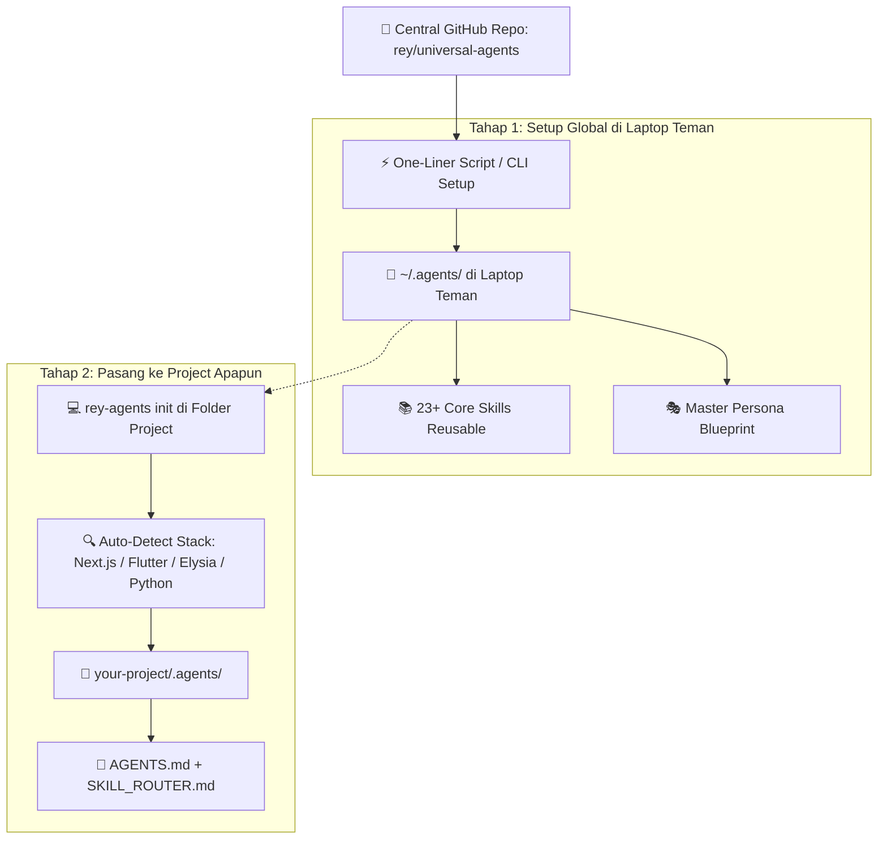

# 📦 Blueprint Distribusi Universal Agent System (Shareable & Installable)

> **Visi:** Membangun satu repositori sentral "Universal Agents" yang dapat dipasang oleh teman/kolaborator ke laptop mereka semudah menjalankan 1 perintah (*one-liner*), mendukung berbagai macam AI Coding Assistant (Antigravity, Cursor, Claude Code, Windsurf, Copilot), serta beradaptasi otomatis dengan tech-stack proyek mereka.

---

## 💡 1. Validasi Ide: Kenapa Ini Langkah Sangat Tepat?

Ide membuat repositori terpusat yang bisa dibagikan dan di-install dengan sekali jalan adalah langkah yang **sangat matang dan tepat sasaran**:
* **Analoginya:** Seperti `shadcn/ui` untuk komponen, atau `oh-my-zsh` untuk terminal. Daripada temanmu harus meng-copy folder `.agents` seberat puluhan ribu baris manual ke tiap project, mereka cukup menjalankan perintah installer.
* **Problem yang terselesaikan:** Menghilangkan *copy-paste drift*, memastikan pembaruan skill/protokol cukup dilakukan di 1 repo sumber, dan temanmu yang awam sekalipun tidak akan bingung mengatur konfigurasi agent.

---

## 🛠️ 2. Tiga Pilihan Mekanisme Distribusi (Paling Direkomendasikan)

Untuk memberikan pengalaman install paling mulus bagi temanmu, ada 3 metode utama yang bisa dipilih:

```
┌────────────────────────────────────────────────────────────────────────┐
│                   SPEKTRUM METODE DISTRIBUSI REPO                      │
├────────────────────────────────────────────────────────────────────────┤
│                                                                        │
│   [Opsi A: CLI Tool (NPX / Bunx)]      ⭐⭐⭐⭐⭐ (Paling Modern & Elegan)│
│   • npx rey-agents init                                                │
│   • Interaktif: pilih tech stack, otomatis inject AGENTS.md & rules.   │
│                                                                        │
│   [Opsi B: One-Liner Script (curl/irm)] ⭐⭐⭐⭐  (Paling Cepat / Zero-Dep)│
│   • irm https://git.io/rey-agents | iex (Windows)                      │
│   • curl -fsSL https://git.io/rey-agents | bash (macOS/Linux)          │
│   • Cocok untuk setup global environment (~/.agents).                  │
│                                                                        │
│   [Opsi C: Degit / Git Template]        ⭐⭐⭐   (Sederhana)          │
│   • npx degit username/universal-agents .agents                        │
│   • Download langsung tanpa git history.                               │
│                                                                        │
└────────────────────────────────────────────────────────────────────────┘
```

---

## 🏆 3. Arsitektur Terbaik: Kombinasi Hybrid (Global Hub + Local Init)

Arsitektur yang paling direkomendasikan adalah **Hybrid Pattern**:



### Keuntungan Pendekatan Hybrid:
1. **Hemat Disk & Indexing Cepat:** File skill (yang ukurannya puluhan ribu baris) hanya disimpan **satu kali** di direktori pengguna (`~/.agents`). Proyek teman tidak akan membengkak.
2. **Setup Project Instan (Hitungan Detik):** Ketika teman berada di dalam folder project baru, mereka cukup mengetik:
   ```bash
   npx rey-agents init
   ```
   CLI akan mendeteksi tipe project (misal: "Oh ini Next.js + Tailwind!"), lalu men-generate `AGENTS.md`, `SKILL_ROUTER.md`, dan rules yang relevan tanpa mengotori repo dengan duplikasi ribuan file skill.

---

## 🗂️ 4. Struktur Repositori Sumber (`universal-agents`)

Berikut adalah struktur folder ideal untuk repositori sentral Anda di GitHub:

```text
universal-agents/
├── package.json                 # Konfigurasi bin CLI (opsional jika dibuat npx package)
├── README.md                    # Dokumentasi & cara pakai (Quickstart)
├── install.ps1                  # Installer untuk Windows PowerShell
├── install.sh                   # Installer untuk macOS / Linux
│
├── core-skills/                 # Sumber pustaka skill terpusat
│   ├── design-taste-frontend/
│   ├── full-output-enforcement/
│   ├── context7-mcp/
│   ├── responsive-craft/
│   └── ...
│
├── templates/                   # Template siap pakai sesuai jenis proyek
│   ├── universal/               # Template dasar (Intent Triage + Skill Router)
│   │   ├── AGENTS.md
│   │   └── .agents/
│   │       ├── ORCHESTRATOR.md
│   │       ├── SKILL_ROUTER.md
│   │       └── WORKFLOWS.md
│   ├── nextjs-fullstack/        # Template untuk Next.js / React
│   ├── flutter-mobile/          # Template untuk Flutter / Dart
│   ├── iot-embedded/            # Template untuk ESP32 / IoT / Firmware
│   └── monorepo/                # Template untuk Monorepo (Moonrepo / Turborepo)
│
└── adapters/                    # Jembatan kompatibilitas multi-assistant
    ├── .cursorrules             # Symlink / export ke Cursor IDE
    ├── .windsurfrules           # Export ke Windsurf IDE
    └── copilot-instructions.md  # Export ke VS Code Copilot
```

---

## 🌐 5. Kompatibilitas Lintas Alat AI (Universal Interoperability)

Agar setup ini benar-benar kompatibel apapun alat AI yang dipakai teman Anda:

| AI Coding Tool | File yang Dibaca Otomatis | Cara Kerja di Setup Universal |
| :--- | :--- | :--- |
| **Antigravity / Gemini CLI** | `AGENTS.md` + `.agents/skills` | Native support langsung membaca root `AGENTS.md` dan routing skill. |
| **Claude Code** | `CLAUDE.md` + `.agents/skills` | Script installer membuat `CLAUDE.md` yang mengimpor/referensi ke `AGENTS.md`. |
| **Cursor IDE** | `.cursorrules` / `.cursor/rules/` | Installer men-generate `.cursorrules` otomatis yang membaca instruksi `AGENTS.md`. |
| **Windsurf (Cascade)** | `.windsurfrules` | Installer membuat file `.windsurfrules` yang sinkron dengan orchestrator. |
| **GitHub Copilot** | `.github/copilot-instructions.md` | Installer menautkan petunjuk Copilot ke `AGENTS.md`. |

> [!TIP]
> **Single Source of Truth:** Jadikan `AGENTS.md` sebagai file master utama. Alat AI lain (`.cursorrules`, `CLAUDE.md`, dll.) cukup memuat instruksi sederhana:  
> *"Always adhere strictly to the rules, protocols, and skill routers defined in `AGENTS.md` and `.agents/`."*

---

## ⚡ 6. Skenario Pengalaman Teman Anda (User Journey)

Berikut gambaran betapa mudahnya bagi teman Anda ketika ingin menggunakan setup ini:

### Skenario 1: Teman Baru Pertama Kali Pasang (One-Time Setup)
Temanmu cukup membuka terminal dan menjalankan:

* **Di Windows (PowerShell):**
  ```powershell
  irm https://raw.githubusercontent.com/username/universal-agents/main/install.ps1 | iex
  ```
* **Di macOS / Linux:**
  ```bash
  curl -fsSL https://raw.githubusercontent.com/username/universal-agents/main/install.sh | bash
  ```
Script ini akan:
1. Meng-clone pustaka core skills ke `~/.agents/skills`.
2. Mendaftarkan CLI global (misal alias `rey-agents`).
3. Selesai dalam waktu kurang dari 15 detik!

---

### Skenario 2: Teman Menjalankan di Proyek Baru Mereka
Ketika temanmu sedang membuat project baru (misal proyek web Next.js atau Flutter):

```bash
cd my-cool-project
rey-agents init
```

Terminal akan menampilkan wizard interaktif ramah:
```text
🚀 Universal Agents Setup Wizard
✔ Detected project type: Next.js + TypeScript
✔ AI Tool detected: Cursor & Antigravity

? Choose Agent Profile:
  ❯ 🌟 Full-Featured (Skill Router + Anti-Slop + Full Output)
    ⚡ Lightweight (Basic Guardrails & Skill Router only)
    🎯 Monorepo Special (Cross-Domain Conflict Resolution)

Installing configuration...
✔ Created AGENTS.md
✔ Created .agents/ORCHESTRATOR.md
✔ Created .agents/SKILL_ROUTER.md
✔ Linked global skills from ~/.agents/skills
✨ Done! Your AI Agent is now supercharged and ready to assist.
```

---

## 🚀 7. Rencana Aksi (Action Plan) untuk Mulai Membangun

Untuk merealisasikannya, langkah praktis yang bisa kita ambil:
1. **Langkah 1: Kurasi Core Skills**  
   Pilih 23 skill terbaik dari `~/.agents/skills` Anda yang bersifat universal (design, code completion, mcp, debugging, responsive).
2. **Langkah 2: Buat Template Universal Bersih**  
   Ambil pola orchestrator & skill router terbaik dari `see-mbg`, kombinasikan dengan aturan anti-slop dari `shape-tool`.
3. **Langkah 3: Tulis Script Installer Sederhana (`install.ps1` & `install.sh`)**  
   Script pendek untuk download ke folder pengguna dan link ke CLI.
4. **Langkah 4: Push ke GitHub & Test Install di Folder Terpisah.**
