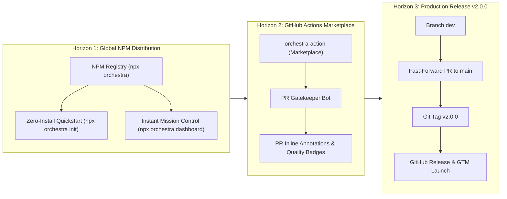
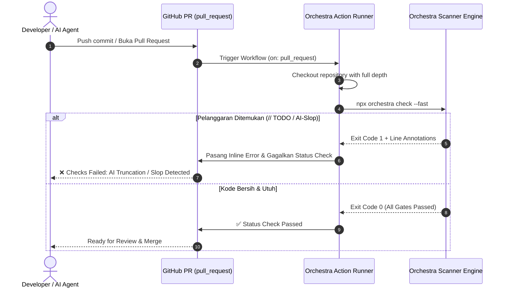
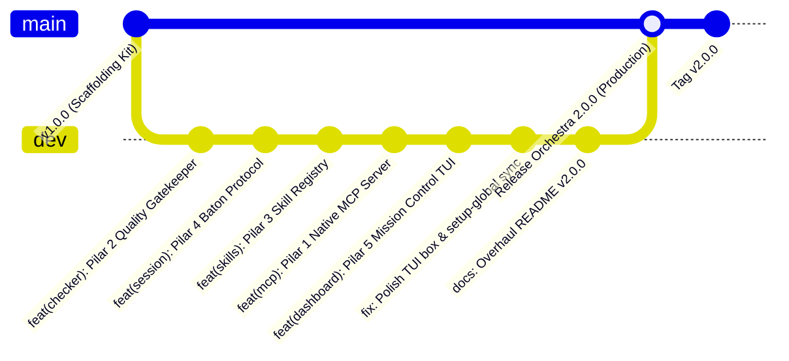

# 🚀 ORCHESTRA: Next Horizons Strategy & Master Blueprint
> **Dokumen Strategi Eksekusi: Distribusi Global, Integrasi CI/CD Marketplace, dan Rilis Resmi Orchestra 2.0**  
> *Author & Lead Architect: Rey Cannavaro*  
> *Target Rilis: Orchestra v2.0.0 Production*  
> *Status: Ready for Execution*  

---

## 🌌 1. Executive Summary & Visi Strategis

Setelah sukses menyelesaikan seluruh **5 Pilar Utama Arsitektur Orchestra 2.0** pada branch `dev`:
1. 🔌 **Pilar 1:** Native JSON-RPC 2.0 MCP Server (`orchestra mcp`)
2. 🛡️ **Pilar 2:** Quality Gatekeeper CLI & Pre-commit Hooks (`orchestra check`)
3. 📦 **Pilar 3:** Modular Skill Registry & Package Manager (`orchestra skill`)
4. 📜 **Pilar 4:** Dynamic Baton Protocol & Session Continuity (`orchestra session`)
5. 🖥️ **Pilar 5:** Interactive Terminal UI / Mission Control (`orchestra dashboard`)

Tantangan berikutnya bukan lagi pada rekayasa kode internal, melainkan pada **distribusi global (*Global Reach*), adopsi industri (*Developer Adoption*), dan proteksi ekosistem (*Continuous Governance*)**.

Dokumen ini membedah secara mendalam konsep, arsitektur teknis, dan langkah eksekusi konkret untuk **3 Inisiatif Next Horizons**:



---

## 📦 2. Horizon 1: Global NPM Distribution (`npx orchestra`)

### 2.1 Konsep & Pengalaman Pengguna (UX)
Tujuan utama distribusi NPM adalah menghilangkan friksi instalasi (*zero-friction onboarding*):
* **Tanpa Git Clone:** Pengguna atau kolaborator tim tidak perlu meng-clone repositori `orchestra` secara manual ke laptop mereka.
* **Zero Global Pollution:** Pengguna tidak wajib melakukan `npm install -g`. Cukup mengetik `npx orchestra <command>`, Node.js akan mengunduh tarball temporer secara instan dan mengeksekusinya.
* **Keunggulan Zero-Dependency:** Karena Orchestra dibangun menggunakan Node.js Standard Library murni (`node:fs`, `node:path`, `node:readline`, `node:child_process`, `node:crypto`), ukuran package sangat kecil (**< 1.5 MB** termasuk 23 template skill). Waktu download dan inisialisasi hanya memakan waktu **< 2 detik**!

### 2.2 Strategi Penamaan Package di NPM
Di ekosistem NPM (`npmjs.com`), nama package publik bersifat *first-come, first-served*:
1. **Pilihan Utama (Single Word):** `orchestra`
   * *Status:* Jika nama `orchestra` belum terpakai atau tidak aktif, klaim nama ini untuk kesederhanaan maksimal (`npx orchestra init`).
2. **Pilihan Alternatif Kredibel (Unscoped / Scoped):**
   * `orchestra-cli` (sangat standar industri seperti `vue-cli`, `prisma-cli`).
   * `orchestra-ai` / `orchestra-os` (menonjolkan posisi sebagai Multi-Agent OS).
   * `@reycannavaro/orchestra` (nama scoped resmi di bawah identitas Rey Cannavaro).

> [!TIP]
> Di `package.json`, kita bisa mempertahankan `bin: { "orchestra": "./bin/index.js" }`. Jika package dipublish sebagai `@reycannavaro/orchestra` atau `orchestra-cli`, perintah bin tetap bisa dipanggil langsung dengan `npx @reycannavaro/orchestra init` atau alias global `orchestra`.

### 2.3 Optimasi Packaging (`.npmignore`)
Agar tarball package di NPM tetap sangat ringan dan tidak memuat file riwayat dev atau pengujian internal, buat file `.npmignore`:

```text
# .npmignore
.git/
.github/
.cursor/
.agents/history/
tests/
*.log
docs/ANALYSIS_REPORT.md
docs/DISTRIBUTION_BLUEPRINT.md
```

File yang wajib disertakan dalam tarball:
* `bin/` (CLI executable)
* `lib/` (Core engine: mcp, session, skills, checker, dashboard, utils)
* `core-skills/` (23 core skills)
* `registry/` (index manifest)
* `templates/` (scaffolding profiles: universal, nextjs, flutter, monorepo)
* `package.json`, `README.md`, `LICENSE`, `install.ps1`, `install.sh`

### 2.4 Langkah Teknis Eksekusi Publikasi ke NPM
1. **Buat / Login Akun NPM:**
   ```bash
   npm login
   # Masukkan username, password, email, dan 2FA OTP
   ```
2. **Verifikasi Hak Akses & Status Package:**
   ```bash
   npm whoami
   npm view orchestra
   ```
3. **Dry-Run Verifikasi Tarball:**
   ```bash
   npm pack --dry-run
   # Periksa daftar file yang masuk ke dalam arsip tarball
   ```
4. **Publish Resmi ke NPM Registry:**
   ```bash
   npm publish --access public
   ```
5. **Otomasi CD (Continuous Delivery) via GitHub Actions:**
   Buat workflow `.github/workflows/publish-npm.yml` yang otomatis mem-publish package setiap kali tag rilis dibuat di GitHub:
   ```yaml
   name: Publish to NPM
   on:
     release:
       types: [published]
   jobs:
     publish:
       runs-on: ubuntu-latest
       steps:
         - uses: actions/checkout@v4
         - uses: actions/setup-node@v4
           with:
             node-version: 20
             registry-url: 'https://registry.npmjs.org'
         - run: npm publish --access public --provenance
           env:
             NODE_AUTH_TOKEN: ${{ secrets.NPM_TOKEN }}
   ```

---

## 🛡️ 3. Horizon 2: GitHub Actions Marketplace Integration (`orchestra-action`)

### 3.1 Konsep & Pengalaman Pengguna (UX)
Ketika sebuah tim menggunakan AI coding assistants (seperti Cursor, Claude Code, GitHub Copilot), kode yang dihasilkan sering kali langsung diajukan ke dalam Pull Request (PR) tanpa verifikasi mendalam.

**Orchestra GitHub Action** bertindak sebagai **Automated AI Quality Guardrail**:
1. **PR Quality Check:** Setiap ada PR masuk, GitHub Actions otomatis menjalankan `orchestra check --staged`.
2. **Inline PR Annotations:** Jika AI meninggalkan `// TODO`, stub fungsi kosong, atau gradient `purple-500 -> pink-500`, Action akan memunculkan anotasi merah (*inline error annotation*) tepat di baris file yang bersangkutan di tab *Files Changed* GitHub!
3. **PR Blocker Gate:** PR tidak bisa di-merge (*status check failing*) sampai developer/AI memperbaiki kode tersebut menjadi utuh dan mematuhi standar desain.
4. **Step Summary Report:** Menampilkan dashboard ringkasan diagnosa di halaman eksekusi workflow GitHub Actions.



### 3.2 Spesifikasi `action.yml` (Composite GitHub Action)
Kita dapat membuat repositori mandiri `ReyCannavaro/orchestra-action` atau menyertakannya langsung di dalam repositori Orchestra pada folder `action/`:

```yaml
# action.yml
name: 'Orchestra AI Quality Gatekeeper'
description: 'Enforce anti-truncation, anti-slop, and multi-agent health guardrails on Pull Requests'
author: 'Rey Cannavaro'
branding:
  icon: 'shield'
  color: 'purple'

inputs:
  fast:
    description: 'Run fast AST/regex scanning, skip slow compilers'
    required: false
    default: 'true'
  fail_on_warning:
    description: 'Whether warnings should fail the PR check'
    required: false
    default: 'false'

runs:
  using: 'composite'
  steps:
    - name: Set up Node.js
      uses: actions/setup-node@v4
      with:
        node-version: '>=18'

    - name: Run Orchestra Quality Gatekeeper
      shell: bash
      run: |
        ARGS=""
        if [ "${{ inputs.fast }}" = "true" ]; then
          ARGS="$ARGS --fast"
        fi
        node ${{ github.action_path }}/bin/index.js check $ARGS
```

### 3.3 Cara Pengguna Memasang di Repo Mereka
Developer manapun di dunia cukup menambahkan file `.github/workflows/orchestra-ci.yml` di repository mereka:

```yaml
name: Orchestra Gatekeeper
on:
  pull_request:
    branches: [main, dev]

jobs:
  guardrails:
    runs-on: ubuntu-latest
    steps:
      - uses: actions/checkout@v4
        with:
          fetch-depth: 0 # Wajib agar Git diff dapat mendeteksi file yang diubah
      - uses: ReyCannavaro/orchestra-action@v2
```

### 3.4 Langkah Pendaftaran ke GitHub Marketplace
1. Masuk ke halaman repositori `ReyCannavaro/orchestra` atau `ReyCannavaro/orchestra-action`.
2. Klik tombol **Draft a release** pada panel sebelah kanan.
3. Centang opsi: **"Publish this Action to the GitHub Marketplace"**.
4. Lengkapi kategori (misal: *Code quality* & *Continuous integration*).
5. Pasang icon `shield` dan warna `purple`.
6. Simpan dan publish. Action akan langsung terindeks di [GitHub Marketplace](https://github.com/marketplace).

---

## 🔀 4. Horizon 3: Merge ke Branch `main` & Rilis Resmi v2.0.0

### 4.1 Standar Operasional Prosedur (SOP) Penggabungan Cabang
Seluruh pekerjaan 5 pilar telah selesai diuji dan berada di branch `dev`. Prosedur penggabungan ke `main` harus dilakukan secara bersih (*Fast-Forward / Clean Merge*):



#### Langkah Perintah Git:
```powershell
# 1. Pastikan branch dev bersih dan sinkron dengan remote
git checkout dev
git pull origin dev

# 2. Pindah ke branch main
git checkout main
git pull origin main

# 3. Gabungkan branch dev ke main
git merge dev --no-ff -m "chore(release): merge dev to main for Orchestra 2.0.0 production release"

# 4. Buat Git Annotated Tag v2.0.0
git tag -a v2.0.0 -m "Orchestra 2.0.0: The Symphony Multi-Agent Operating System"

# 5. Push branch main dan tag ke GitHub
git push origin main
git push origin v2.0.0
```

---

### 4.2 Draft Release Notes Resmi GitHub Release v2.0.0

Berikut template rilis resmi yang siap di-copy-paste ke halaman GitHub Releases:

```markdown
# 🎻 ORCHESTRA v2.0.0 — The Symphony Multi-Agent Operating System

Kami dengan bangga mempersembahkan rilis besar **Orchestra 2.0.0**! 🎉

Orchestra berevolusi dari kit scaffolding pasif menjadi **Operating System Otonom Multi-Agent** pertama yang menerapkan filosofi Orkestra Simfoni untuk memimpin era pengembangan perangkat lunak berbasis AI.

---

### 🌟 5 Pilar Transformasi Utama di Versi 2.0.0:

1. 🖥️ **Interactive Mission Control Dashboard (`orchestra dashboard`):**
   * Antarmuka TUI mewah zero-dependency berbasis ANSI box-drawing.
   * Real-time monitoring: Multi-agent health, active roadmap, pemegang baton, stack detection, dan hotkeys interaktif (`[c]`, `[b]`, `[m]`, `[r]`).
2. 🔌 **Native Zero-Dependency MCP Server (`orchestra mcp`):**
   * Server JSON-RPC 2.0 over STDIO berkecepatan tinggi (<10ms).
   * 6 active tools untuk AI: `resolve_skill`, `acquire_baton`, `release_baton`, `verify_diff`, `session_status`, dan `list_skills`.
   * Generator otomatis konfigurasi multi-IDE: Cursor (`.cursor/mcp.json`), Claude Desktop, dan Antigravity.
3. 📦 **Modular Skill Registry & Package Manager (`orchestra skill`):**
   * Registry mandiri dengan manifes standar `skill.json` dan `registry/index.json`.
   * Perintah manajemen lengkap: `search`, `add`, `list`, `new`, `update`, `remove`, dan `setup-global`.
   * Auto-registration skill baru ke dalam matriks `.agents/SKILL_ROUTER.md`.
4. 📜 **Dynamic Baton Protocol & Session Handover Engine (`orchestra session`):**
   * Mengakhiri masalah AI amnesia lintas sesi atau pergantian editor (Cursor ➔ Claude Code ➔ Antigravity).
   * Menegakkan *Single-Writer Invariant* dan auto-export ringkasan ke `docs/ADR.md`.
5. 🛡️ **Quality Gatekeeper CLI & Git Hooks (`orchestra check`):**
   * Scanner AST regex multi-layer yang menolak `// TODO`, kode terpotong, gradient ungu-pink murahan, dan shadow neon AI.
   * Pemasang hook otomatis Git pre-commit (`orchestra install-hook`) dan GitHub Actions CI generator (`orchestra init-ci`).

---

### ⚡ Quick Install:
```bash
# Pasang ke proyek apa pun
npx orchestra init

# Buka Mission Control
npx orchestra dashboard
```

Diciptakan dengan dedikasi oleh **Rey Cannavaro**.
```

---

## 💼 5. Horizon 4: Strategi Komersialisasi & Ekosistem Bisnis (The Commercial Horizon)

Jika Orchestra ingin dikembangkan lebih jauh menjadi produk komersial bernilai tinggi, model bisnis paling ideal adalah **Open-Core Model** (seperti Docker, Supabase, atau Prisma):

```
┌────────────────────────────────────────────────────────────────────────┐
│                   ORCHESTRA VALUE PYRAMID & BUSINESS MODEL             │
├────────────────────────────────────────────────────────────────────────┤
│                                                                        │
│   [LAYER 3: ORCHESTRA ENTERPRISE (SaaS / Private VPC)]                 │
│   • Private Skill Registry (Private internal company APIs & compliance)│
│   • Multi-Tenant Web Dashboard (Team analytics & token usage metrics)  │
│   • GitHub PR Review Bot Hosted (Zero-config App)                      │
│   • Monetisasi: $19 - $49 / developer / bulan                          │
│                                                                        │
│   [LAYER 2: COMMUNITY ECOSYSTEM (Marketplace & Plugins)]               │
│   • Verified Skill Marketplace (Creator monetization & revenue share)  │
│   • IDE Extensions (VS Code & Cursor Native Sidebars)                  │
│                                                                        │
│   [LAYER 1: ORCHESTRA OPEN-SOURCE CORE (Free Forever / MIT)]           │
│   • CLI (init, check, session, skill, mcp, dashboard)                  │
│   • 23 Core Skills Library                                             │
│   • Baton Protocol Engine & Git Pre-commit Hooks                       │
│                                                                        │
└────────────────────────────────────────────────────────────────────────┘
```

### 5.1 Tiga Produk Komersial Bernilai Tinggi:
1. **Orchestra Cloud (Web Control Plane):**
   * Bukan sekadar TUI di terminal lokal, melainkan web dashboard berbasis Next.js di mana Engineering Manager / CTO bisa melihat semua sesi aktif para engineer dan agent di seluruh organisasi.
2. **Private Skill Registry:**
   * Perusahaan besar (Fintech, Healthcare, Banking) tidak boleh membagikan aturan arsitektur internal mereka ke publik. Mereka dapat membeli *Orchestra Private Registry* untuk mendistribusikan skill internal ke engineer mereka secara aman.
3. **Orchestra GitHub App (Hosted Bot):**
   * Layanan bot GitHub yang otomatis mereview PR tim, memberi skor kualitas kode AI (*AI Readiness Score*), dan memblokir pelanggaran tanpa perlu setup server sendiri.

---

## 📋 6. Matriks Aksi & Checklist Eksekusi (Actionable Roadmap)

Untuk merealisasikan inisiatif di atas, berikut checklist urutan eksekusinya:

| Fase | Target Aksi | Estimasi Waktu | Deliverable Utama |
|---|---|---|---|
| **Fase 1** | **Merge dev ke main & Git Tagging** | 10 Menit | Branch `main` sinkron, tag `v2.0.0` dibuat |
| **Fase 2** | **Publish Package ke NPM** | 15 Menit | `npx orchestra` aktif secara global di registry |
| **Fase 3** | **Draft GitHub Release v2.0.0** | 10 Menit | Halaman rilis resmi publik di repository |
| **Fase 4** | **GitHub Actions Marketplace Setup** | 20 Menit | `action.yml` terdaftar di Marketplace |
| **Fase 5** | **Community Announcement (GTM)** | 30 Menit | Post di Twitter/X, LinkedIn, dan Reddit r/LocalLLaMA |

---

## 🏁 7. Kesimpulan

Dengan mengeksekusi strategi **Next Horizons** ini:
* **Orchestra** tidak lagi sekadar repositori lokal di laptop, melainkan **standar industri global** yang siap dipakai oleh ribuan developer di seluruh dunia.
* Siapapun dapat memasang dan merasakan kekuatan orkestrasi multi-agent hanya dengan satu perintah:  
  👉 `npx orchestra init` 🎻✨
