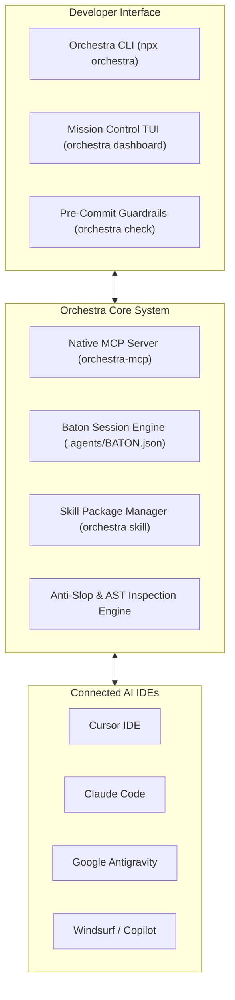
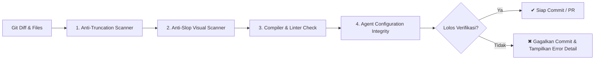
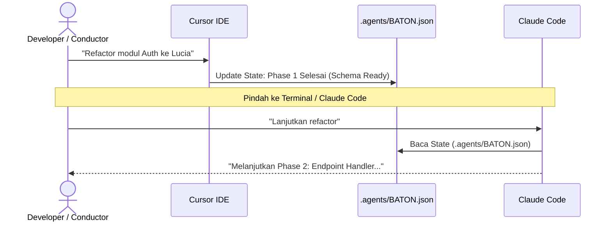

# 🎻 ORCHESTRA: The Grand Evolution Blueprint & Engineering Roadmap
> **Dokumen Visi & Rencana Eksekusi Teknis: Transformasi Orchestra Menjadi Autonomous AI Agent Operating System**  
> *Author & Architect: Rey Cannavaro*  
> *Versi Rencana: 2.0.0-alpha*  
> *Status: Ready for Phased Execution*  

---

## 🌌 Visi Utama: Dari Scaffolding Kit Menuju AI Operating System

Saat ini **Orchestra** telah sukses berfungsi sebagai kit perancah (*scaffolding kit*) statis dengan pustaka 23+ core skills dan aturan 4-tahap siklus kerja (*Intent Triage ➔ Skill Resolution ➔ Phased SOP ➔ Pre-Flight Verification*).

Namun, untuk menjadikan Orchestra platform yang **sangat powerful, tak tergantikan, dan berstandar enterprise**, Orchestra harus berevolusi dari konfigurasi teks pasif (*passive markdown guidance*) menjadi **sistem aktif (*active agent coordination engine*)**.



Dokumen ini membedah secara mendalam **5 Pilar Strategis** yang akan kita eksekusi secara bertahap.

---

## 📑 Daftar Isi & Struktur Rencana

- [Pilar 1: Native Orchestra MCP Server (`orchestra-mcp`)](#1-pilar-1-native-orchestra-mcp-server-orchestra-mcp)
  - [1.1 Arsitektur & Protokol Komunikasi](#11-arsitektur--protokol-komunikasi)
  - [1.2 Spesifikasi Tools MCP yang Disediakan](#12-spesifikasi-tools-mcp-yang-disediakan)
  - [1.3 Konfigurasi Multi-IDE Otomatis](#13-konfigurasi-multi-ide-otomatis)
  - [1.4 Keuntungan Strategis Dibanding Markdown Pasif](#14-keuntungan-strategis-dibanding-markdown-pasif)
- [Pilar 2: Quality Gatekeeper CLI (`orchestra check` / `doctor`)](#2-pilar-2-quality-gatekeeper-cli-orchestra-check--doctor)
  - [2.1 Arsitektur Scanner Engine](#21-arsitektur-scanner-engine)
  - [2.2 Rule 1: Anti-Truncation & Todo Guard](#22-rule-1-anti-truncation--todo-guard)
  - [2.3 Rule 2: Anti-Slop Visual & CSS Inspector](#23-rule-2-anti-slop-visual--css-inspector)
  - [2.4 Rule 3: Multi-Stack Compiler & Linter Runner](#24-rule-3-multi-stack-compiler--linter-runner)
  - [2.5 Rule 4: Agent Health & Configuration Integrity](#25-rule-4-agent-health--configuration-integrity)
  - [2.6 Integrasi Git Pre-Commit Hook & GitHub Actions](#26-integrasi-git-pre-commit-hook--github-actions)
  - [2.7 Fitur Auto-Fix (`orchestra check --fix`)](#27-fitur-auto-fix-orchestra-check---fix)
- [Pilar 3: Modular Skill Registry & Package Manager (`orchestra skill`)](#3-pilar-3-modular-skill-registry--package-manager-orchestra-skill)
  - [3.1 Standarisasi Format Manifest Skill (`skill.json`)](#31-standarisasi-format-manifest-skill-skilljson)
  - [3.2 Spesifikasi Perintah CLI Skill](#32-spesifikasi-perintah-cli-skill)
  - [3.3 Arsitektur Cloud Registry & CDN Distribusi](#33-arsitektur-cloud-registry--cdn-distribusi)
  - [3.4 Mekanisme Kontribusi Open-Source (Community Skills)](#34-mekanisme-kontribusi-open-source-community-skills)
- [Pilar 4: Dynamic Baton Protocol & Session Handover (`.agents/BATON.json`)](#4-pilar-4-dynamic-baton-protocol--session-handover-agentsbatonjson)
  - [4.1 Solusi Masalah AI Amnesia & Sesi Terfragmentasi](#41-solusi-masalah-ai-amnesia--sesi-terfragmentasi)
  - [4.2 Skema Data `.agents/BATON.json`](#42-skema-data-agentsbatonjson)
  - [4.3 Perintah CLI Manajemen Sesi](#43-perintah-cli-manajemen-sesi)
  - [4.4 Alur Handover Lintas Editor (Cross-Tool Workflow)](#44-alur-handover-lintas-editor-cross-tool-workflow)
- [Pilar 5: Interactive Terminal UI / Mission Control (`orchestra dashboard`)](#5-pilar-5-interactive-terminal-ui--mission-control-orchestra-dashboard)
  - [5.1 Konsep Tampilan & Pengalaman Pengguna (TUI Experience)](#51-konsep-tampilan--pengalaman-pengguna-tui-experience)
  - [5.2 Modul-Modul Panel Dashboard](#52-modul-modul-panel-dashboard)
  - [5.3 Pilihan Teknologi (Zero-Dependency vs Lightweight Ink)](#53-pilihan-teknologi-zero-dependency-vs-lightweight-ink)
- [🗺️ Matriks Prioritas & Urutan Eksekusi](#️-matriks-prioritas--urutan-eksekusi)

---

## 1. Pilar 1: Native Orchestra MCP Server (`orchestra-mcp`)

### 1.1 Arsitektur & Protokol Komunikasi
Model Context Protocol (MCP) adalah standar terbuka yang kini didukung oleh Cursor, Claude Code, Antigravity, dan Windsurf. Dengan membuat `orchestra-mcp`, Orchestra bertransformasi dari sekadar pembaca teks menjadi **penyedia tools aktif**.

```text
[AI Assistant: Claude / Cursor / Antigravity]
                     │
         JSON-RPC over STDIO
                     ▼
        [orchestra-mcp binary]
        ├── Tool Dispatcher
        ├── Dynamic Skill Resolver Engine
        ├── Baton State Lockfile Manager
        └── Local AST Code Verification Engine
```

### 1.2 Spesifikasi Tools MCP yang Disediakan

#### 1.2.1 `orchestra_resolve_skill`
* **Input:** `{ "task_description": string, "files_involved": string[] }`
* **Fungsi:** AI tidak perlu membaca 23 skill secara manual. Cukup kirimkan deskripsi tugasnya (misal: *"Saya ingin membuat komponen dropdown animasi dengan Tailwind"*), dan MCP akan mengembalikan isi instruksi skill `design-taste-frontend` + `responsive-craft` yang paling relevan.
* **Output:** Ringkasan panduan skill, design tokens, dan aturan spesifik yang wajib dipatuhi.

#### 1.2.2 `orchestra_acquire_baton`
* **Input:** `{ "agent_role": string, "task_intent": string, "target_files": string[] }`
* **Fungsi:** Menerapkan *Single-Writer Invariant*. Memastikan hanya ada 1 agent/proses yang memiliki izin untuk memodifikasi file target. Mencegah race condition ketika beberapa subagent bekerja simultan.
* **Output:** `{ "granted": boolean, "session_id": string, "expires_at": timestamp }`

#### 1.2.3 `orchestra_release_baton`
* **Input:** `{ "session_id": string, "summary_of_work": string, "modified_files": string[] }`
* **Fungsi:** Menyerahkan kembali token mutasi, mencatat riwayat perubahan ke `.agents/BATON.json`, dan memicu verifikasi otomatis.

#### 1.2.4 `orchestra_verify_diff`
* **Input:** `{ "files": string[] }`
* **Fungsi:** Memeriksa apakah diff pada file-file tersebut mengandung anti-slop violations, truncate placeholder (`// TODO`), atau syntax error sebelum AI menyatakan "Selesai".

### 1.3 Konfigurasi Multi-IDE Otomatis
Orchestra CLI (`npx orchestra init`) akan langsung menginjeksikan konfigurasi MCP siap pakai:
* **Cursor:** `.cursor/mcp.json`
* **Claude Desktop / Claude Code:** `~/.config/claude/claude_desktop_config.json`
* **Antigravity / Gemini CLI:** Settings injection otomatis

### 1.4 Keuntungan Strategis Dibanding Markdown Pasif
* **Penghematan Token:** AI hanya memanggil MCP saat butuh. Context window awal bersih 100%.
* **Kepatuhan 100%:** AI tidak bisa "pura-pura lupa" karena eksekusi dilakukan via fungsi terprogram (tool call), bukan imbauan teks.

---

## 2. Pilar 2: Quality Gatekeeper CLI (`orchestra check` / `doctor`)

### 2.1 Arsitektur Scanner Engine
Perintah `npx orchestra check` adalah benteng pertahanan terakhir. CLI ini membaca `git status` dan `git diff` dari staged/unstaged changes, lalu menjalankan 4 lapisan inspeksi:



### 2.2 Rule 1: Anti-Truncation & Todo Guard
Memeriksa setiap baris yang baru ditambahkan:
* Mendeteksi komentar pemotongan: `// TODO`, `/* ... */`, `// ... rest of code`, `# ... same as before`.
* Mendeteksi fungsi kosong / stub: `function foo() {}`, `throw new UnimplementedError()`.
* **Verdict:** Menolak commit jika ditemukan placeholder yang menandakan AI malas menyelesaikan kode.

### 2.3 Rule 2: Anti-Slop Visual & CSS Inspector
Menganalisis file CSS, JSX, TSX, Vue, dan HTML terhadap pola desain murahan:
* **Deteksi Palette AI Slop:**
  * Gradient generik: `bg-gradient-to-r from-purple-500 to-pink-500` atau kode HEX `#8b5cf6 ➔ #ec4899`.
  * Tombol tanpa state: `<button>` tanpa pseudo-class hover/focus/active.
* **Deteksi Shadow Berlebihan:** Class shadow ekstrim seperti `shadow-2xl shadow-purple-500/50`.
* **Deteksi Layout Rusak:** Kurangnya breakpoint responsif (misal: komponen flex/grid tanpa breakpoint `sm:`, `md:`, `lg:`).

### 2.4 Rule 3: Multi-Stack Compiler & Linter Runner
Orchestra mendeteksi stack proyek dan mengeksekusi linter native secara paralel:
* **Next.js / TypeScript:** Menjalankan `tsc --noEmit` & `eslint`.
* **Flutter:** Menjalankan `flutter analyze` atau `dart analyze`.
* **Python:** Menjalankan `ruff check` atau `mypy`.
* **Monorepo:** Menjalankan `turbo run lint` atau `moon run :lint`.

### 2.5 Rule 4: Agent Health & Configuration Integrity
* Memastikan `AGENTS.md` sinkron dengan konfigurasi `.agents/`.
* Memastikan pointer skill di `SKILL_ROUTER.md` merujuk ke skill yang benar-benar terinstall di laptop/repo.
* Memastikan `.cursorrules` dan `CLAUDE.md` sinkron dengan `AGENTS.md`.

### 2.6 Integrasi Git Pre-Commit Hook & GitHub Actions
* Menambahkan satu perintah instalasi: `npx orchestra install-hook` yang otomatis memasang script ke `.git/hooks/pre-commit`.
* Menyediakan template workflow GitHub Actions: `.github/workflows/orchestra-check.yml` untuk memblokir Pull Request yang berisi kode AI slop.

### 2.7 Fitur Auto-Fix (`orchestra check --fix`)
* Otomatis membersihkan import yang tidak terpakai.
* Otomatis menformat format Markdown/JSON agent yang berantakan.
* Menampilkan saran penggantian warna palette slop ke palette berkelas (misal: Slate/Zinc + Electric Indigo).

---

## 3. Pilar 3: Modular Skill Registry & Package Manager (`orchestra skill`)

### 3.1 Standarisasi Format Manifest Skill (`skill.json`)
Setiap skill diubah menjadi paket modular mandiri yang memiliki manifest formal:

```json
{
  "name": "stripe-billing-pro",
  "version": "1.2.0",
  "description": "Enterprise-grade Stripe integration with Webhook idempotency and customer portal",
  "author": "Rey Cannavaro",
  "tags": ["backend", "payments", "stripe", "webhooks"],
  "compatibility": ["nextjs", "elysia", "express"],
  "entrypoint": "SKILL.md",
  "rules": ["rules/webhook-signature.md", "rules/idempotency.md"],
  "dependencies": ["full-output-enforcement"]
}
```

### 3.2 Spesifikasi Perintah CLI Skill

#### 3.2.1 `npx orchestra skill list`
Menampilkan seluruh skill yang terinstall (baik secara global di `~/.agents/skills` maupun lokal di repositori saat ini).

#### 3.2.2 `npx orchestra skill search <query>`
Mencari skill dari registry pusat Orchestra berdasarkan kata kunci (contoh: `auth`, `redis`, `prisma`, `motion`).

#### 3.2.3 `npx orchestra skill add <skill-name> [--global|--local]`
* Mengunduh skill tertentu langsung dari GitHub/Registry tanpa perlu mengunduh seluruh 23 skill jika tidak dibutuhkan.
* Otomatis mendaftarkan skill baru tersebut ke dalam tabel `SKILL_ROUTER.md` di proyek.

#### 3.2.4 `npx orchestra skill update [--all]`
Memeriksa pembaruan versi skill dari upstream repository dan memperbarui file `SKILL.md` lokal secara aman.

#### 3.2.5 `npx orchestra skill new <name>`
Scaffolding generator bagi developer untuk membuat skill baru dengan struktur rapi (`SKILL.md`, `references/`, `examples/`, `skill.json`).

### 3.3 Arsitektur Cloud Registry & CDN Distribusi
* Menggunakan repositori GitHub `ReyCannavaro/orchestra` sebagai registry utama.
* File index terpusat: `registry/index.json` yang memuat metadata seluruh skill yang tersedia.
* Pengunduhan cepat via raw content GitHub CDN / jsDelivr CDN.

### 3.4 Mekanisme Kontribusi Open-Source (Community Skills)
* Membuka folder `community-skills/` di GitHub.
* Developer lain di seluruh dunia dapat mengajukan Pull Request untuk menambahkan skill mereka (misal: `supabase-expert`, `tailwind-v4-migrator`).
* Orchestra Core Team melakukan review kelayakan sebelum masuk ke registry resmi.

---

## 4. Pilar 4: Dynamic Baton Protocol & Session Handover (`.agents/BATON.json`)

### 4.1 Solusi Masalah AI Amnesia & Sesi Terfragmentasi
Masalah terbesar saat ini: saat kita menutup Cursor dan pindah ke Claude Code (atau saat token context window penuh), AI lupa progres sebelumnya. 

Pilar 4 menghadirkan **State Persistence Layer** sederhana namun tangguh.



### 4.2 Skema Data `.agents/BATON.json`
File state lokal yang tidak memberatkan git (bisa di-commit atau dimasukkan ke `.gitignore` sesuai preferensi tim):

```json
{
  "orchestraVersion": "2.0.0",
  "sessionId": "ses_20261121_0945",
  "activeGoal": "Implement JWT authentication with refresh token rotation",
  "currentPhase": "2_implementation",
  "baton": {
    "holder": "backend-specialist",
    "acquiredAt": "2026-11-21T09:45:00Z",
    "status": "in_progress"
  },
  "roadmap": [
    { "step": 1, "title": "Create User & Session Schema", "status": "completed", "verified": true },
    { "step": 2, "title": "Implement /api/auth Endpoints", "status": "in_progress", "verified": false },
    { "step": 3, "title": "Wire Frontend Auth Forms", "status": "pending", "verified": false },
    { "step": 4, "title": "Pre-Flight Verification", "status": "pending", "verified": false }
  ],
  "touchedFiles": [
    "src/db/schema/users.ts",
    "src/app/api/auth/login/route.ts"
  ],
  "architecturalDecisions": [
    "ADR-001: Menggunakan HTTP-Only cookies untuk refresh token guna mencegah XSS"
  ]
}
```

### 4.3 Perintah CLI Manajemen Sesi
* `npx orchestra session start "Judul Tugas"`: Menginisialisasi sesi baru dan mereset roadmap.
* `npx orchestra session checkpoint`: AI atau developer mencatat checkpoint progress terkini.
* `npx orchestra session status`: Menampilkan ringkasan ringkas di terminal tentang siapa yang sedang memegang tugas dan apa langkah berikutnya.
* `npx orchestra session end`: Menyelesaikan sesi, memvalidasi hasil akhir, dan merangkum *Architectural Decision Record (ADR)* ke dalam `docs/ADR.md`.

### 4.4 Alur Handover Lintas Editor (Cross-Tool Workflow)
AI agent di instruksi `AGENTS.md` akan diberikan arahan:
> *"Sebelum memulai pekerjaan, periksa `.agents/BATON.json`. Jika ada sesi aktif, lanjutkan dari langkah yang bertatus `in_progress` tanpa menimpa langkah yang sudah `completed`."*

---

## 5. Pilar 5: Interactive Terminal UI / Mission Control (`orchestra dashboard`)

### 5.1 Konsep Tampilan & Pengalaman Pengguna (TUI Experience)
Membuka dashboard interaktif langsung di terminal tanpa perlu browser:
```bash
npx orchestra dashboard
# atau
npx orchestra ui
```

Desain terminal menggunakan layout modern (border kotak bersih, indikator warna elegan, navigasi keyboard panah `↑/↓` dan `Enter`).

```text
┌─ 🎻 ORCHESTRA MISSION CONTROL v2.0.0 ──────────────────────────────────────────────┐
│ Target: C:\Users\Rey Cannavaro\orchestra             Stack: Next.js Fullstack (RSC) │
├──────────────────────────┬──────────────────────────────────────────────────────────┤
│ 📊 AGENT HEALTH          │ 🗺️ ACTIVE SKILLS                                         │
│ • AGENTS.md:        ✔ OK │ [X] design-taste-frontend       [X] responsive-craft     │
│ • ORCHESTRATOR.md:  ✔ OK │ [X] full-output-enforcement     [ ] context7-mcp         │
│ • SKILL_ROUTER.md:  ✔ OK │ [ ] browser-use                 [ ] brandkit             │
│ • Linter/Typecheck: ✔ OK │                                                          │
├──────────────────────────┴──────────────────────────────────────────────────────────┤
│ 🎯 ACTIVE BATON SESSION: "Auth Module Refactor"                                      │
│ • Phase 1: Create Schema .................................... [COMPLETED ✔]         │
│ • Phase 2: API Route Handlers ............................... [IN PROGRESS ⚙]        │
│ • Phase 3: Frontend Form Components ......................... [PENDING ⏳]           │
├─────────────────────────────────────────────────────────────────────────────────────┤
│ [C] Run orchestra check    [S] Toggle Skills    [B] Manage Baton    [Q] Quit        │
└─────────────────────────────────────────────────────────────────────────────────────┘
```

### 5.2 Modul-Modul Panel Dashboard
1. **Health Monitor:** Menampilkan kelengkapan konfigurasi AI agent dan integritas repositori secara real-time.
2. **Skill Toggles:** Mengaktifkan atau menonaktifkan skill spesifik ke dalam `SKILL_ROUTER.md` proyek hanya dengan menekan spasi.
3. **Session Live View:** Memonitor status langkah kerja multi-agent yang sedang berjalan.
4. **Quick Actions:**
   - Tombol 1-klik untuk menjalankan `orchestra check`.
   - Tombol 1-klik untuk re-sync global skills.
   - Tombol 1-klik untuk men-generate jembatan `.cursorrules` atau `CLAUDE.md`.

### 5.3 Pilihan Teknologi (Zero-Dependency vs Lightweight Ink)
* **Opsi A (Zero-Dependency ANSI):** Menggunakan native Node.js TTY dan ANSI escape sequences. Keunggulan: Kecepatan startup instan (<20ms) dan tidak memerlukan dependensi tambahan.
* **Opsi B (React Ink / Blessed):** Tampilan lebih kaya komponen, namun membutuhkan dependensi kecil.
* **Keputusan Desain:** Kita akan mulai dengan modul ANSI native yang sangat ringan agar tetap selaras dengan filosofi inti Orchestra: **ringan, instan, dan bebas kembung**.

---

## 🗺️ Matriks Prioritas & Urutan Eksekusi

Agar pengembangan berjalan terarah dan setiap langkah langsung memberikan manfaat nyata, berikut urutan eksekusi bertahap (*Phased Rollout*):

```text
+--------------------------------------------------------------------------------+
| TAHAP 1 (Immediate Impact): Pilar 2 - Quality Gatekeeper (orchestra check)     |
| Goal: Mencegah kode terpotong & AI slop langsung di terminal / pre-commit.     |
+--------------------------------------------------------------------------------+
                                       │
                                       ▼
+--------------------------------------------------------------------------------+
| TAHAP 2 (State Continuity): Pilar 4 - Baton Protocol & Handover Engine         |
| Goal: Menghentikan masalah amnesia AI saat sesi panjang / ganti editor.        |
+--------------------------------------------------------------------------------+
                                       │
                                       ▼
+--------------------------------------------------------------------------------+
| TAHAP 3 (Modularity): Pilar 3 - Skill Registry & Package Manager               |
| Goal: Mengizinkan install skill on-demand (orchestra skill add <name>).        |
+--------------------------------------------------------------------------------+
                                       │
                                       ▼
+--------------------------------------------------------------------------------+
| TAHAP 4 (Active Superpower): Pilar 1 - Native Orchestra MCP Server             |
| Goal: Menghubungkan Cursor/Claude/Antigravity langsung ke tools aktif.         |
+--------------------------------------------------------------------------------+
                                       │
                                       ▼
+--------------------------------------------------------------------------------+
| TAHAP 5 (Visual Mastery): Pilar 5 - Terminal Mission Control Dashboard         |
| Goal: Tampilan TUI interaktif elegan untuk mengontrol seluruh ekosistem agent. |
+--------------------------------------------------------------------------------+
```

---

## 🏁 Penutup

Dengan mengeksekusi 5 pilar ini secara bertahap, **Orchestra** tidak hanya akan menjadi template scaffolding biasa, melainkan **standar industri terdepan dalam rekayasa perangkat lunak otonom multi-agent**.

Dokumen ini menjadi *master blueprint* resmi yang akan kita eksekusi bersama satu per satu. 🎻✨
